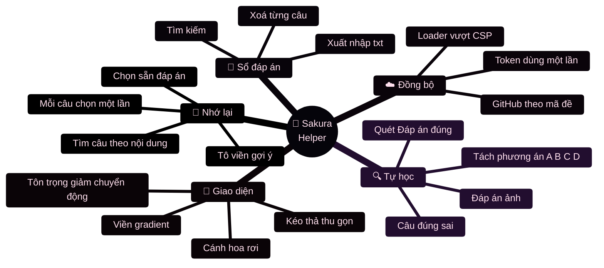
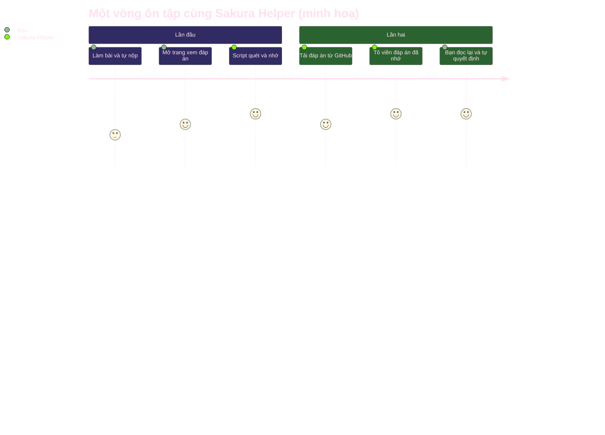
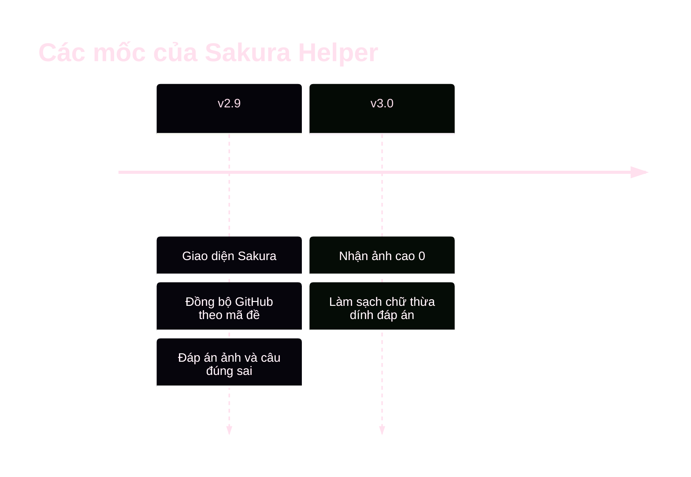
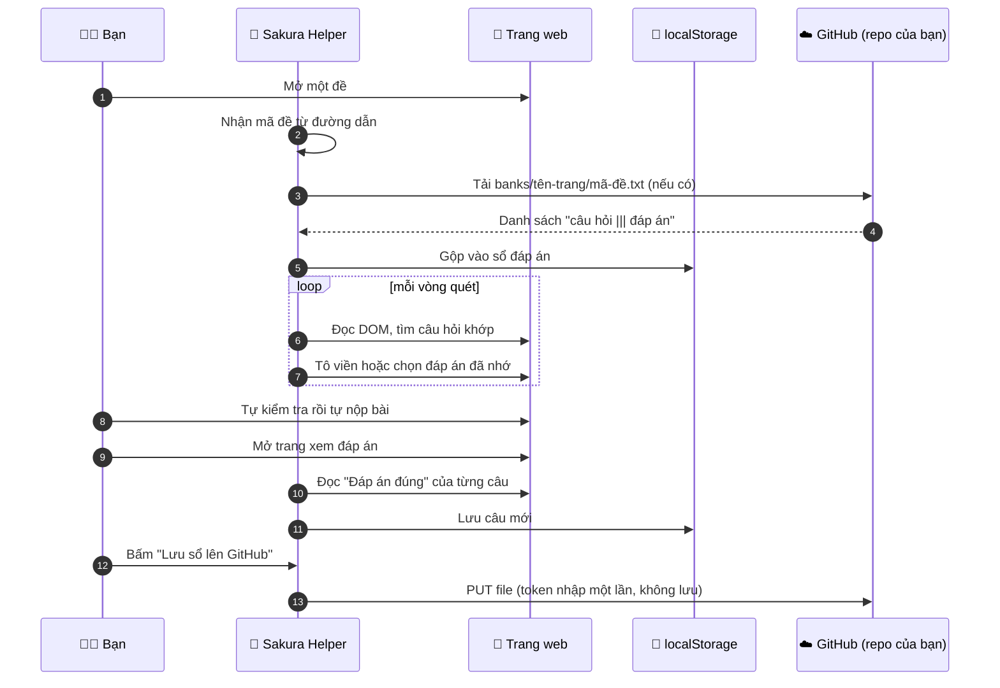

<div align="center">


⋆｡°✩ ようこそ！ ✩°｡⋆<br><table align="center"><tr><td align="center"><br><sub><i>Shin Seiki Evangelion</i></sub></td><td align="center"><br><sub><i>Re:Zero</i></sub></td><td align="center"><br><sub><i>One Punch Man</i></sub></td></tr></table>

</div>


<div align="center">


(๑•̀ㅂ•́)و✧<br><table align="center"><tr><td align="center"><br><sub><i>Hanayamata</i></sub></td><td align="center"><br><sub><i>Shin Seiki Evangelion</i></sub></td><td align="center"><br><sub><i>Macross Delta</i></sub></td></tr></table>

  

  

(ﾉ◕ヮ◕)ﾉ*:･ﾟ✧<br><table align="center"><tr><td align="center"><br><sub><i>Gabriel Dropout</i></sub></td><td align="center"><br><sub><i>Chuunibyou demo Koi ga Shitai</i></sub></td><td align="center"><br><sub><i>Sewayaki Kitsune no Senko-san</i></sub></td></tr></table>

### 🌸 &nbsp;*Mỗi lần làm lại một đề là một lần nhớ thêm một chút* &nbsp;🌸


</div>


<div align="center">

## 🚀 Mục lục 🚀

| | | |
|:-:|:-:|:-:|
| [🌷 Giới thiệu](#-giới-thiệu) | [🎓 Mục đích và phạm vi](#-mục-đích-và-phạm-vi) | [🏯 Kiến trúc](#-kiến-trúc-tổng-quan) |
| [🔬 Giải thích chi tiết](#-giải-thích-chi-tiết-từng-module) | [🧾 Mô hình dữ liệu](#-mô-hình-dữ-liệu) | [🌺 Tính năng](#-tính-năng) |
| [🗂️ Cấu trúc repo](#️-cấu-trúc-repo) | [🚀 Cài đặt](#-cài-đặt) | [🎛️ Bảng điều khiển](#️-bảng-điều-khiển-và-cấu-hình) |
| [🔐 Riêng tư](#-bảo-mật-và-riêng-tư) | [🛠️ Sự cố](#️-xử-lý-sự-cố) | [❓ FAQ](#-faq) |
| [🧭 Hạn chế](#-hạn-chế-và-hướng-phát-triển) | [📖 Thuật ngữ](#-thuật-ngữ) | [📝 Phiên bản](#-lịch-sử-phiên-bản) |

♪(๑ᴖ◡ᴖ๑)♪<br><table align="center"><tr><td align="center"><br><sub><i>Hikikomari Kyuuketsuki no Monmon</i></sub></td><td align="center"><br><sub><i>Shijou Saikyou no Daimaou</i></sub></td><td align="center"><br><sub><i>Tate no Yuusha no Nariagari</i></sub></td></tr></table>

</div>


> 🌸 **Sakura-chan:** 「ようこそ！」 Chào mừng đến với dự án nè~ Cùng đọc từ từ nhé (๑•̀ㅂ•́)و✧

<(≧▽≦)<br><table align="center"><tr><td align="center"><br><sub><i>Shin Seiki Evangelion</i></sub></td><td align="center"><br><sub><i>Macross Delta</i></sub></td><td align="center"><br><sub><i>Anne Happy</i></sub></td></tr></table></div>

## 🌷 Giới thiệu

**School** là kho lưu trữ cá nhân của mình, dùng để thử nghiệm và nghiên cứu cách một trang luyện đề trực tuyến hiển thị câu hỏi, đáp án và kết quả. Thành phần chính là **Sakura Helper**, một *userscript* (đoạn JavaScript chạy trong trình duyệt thông qua Tampermonkey hoặc Violentmonkey) với ba việc rõ ràng:

| 🌸 | Việc script làm | Khi nào |
|:-:|---|---|
| 1 | **Đọc** phần "Đáp án đúng" của từng câu | Ở trang *xem đáp án*, sau khi bạn đã nộp bài |
| 2 | **Lưu** thành sổ đáp án cá nhân (trong trình duyệt, có thể đồng bộ lên GitHub của bạn) | Ngay sau khi đọc |
| 3 | **Gợi ý lại** bằng cách tô viền, hoặc chọn sẵn, đáp án đã nhớ | Khi bạn *làm lại cùng đề* |

Script **không tự nộp bài**, **không đăng nhập hộ**, **không gửi dữ liệu của bạn cho bên thứ ba**. Mọi quyết định cuối cùng đều do bạn.

### ⏱️ Tóm tắt trong 30 giây

```text
làm bài  ->  nộp bài  ->  mở trang xem đáp án  ->  script tự quét và nhớ
                                                        |
        bạn tự nộp  <-  bạn xem lại  <-  script gợi ý  <-  làm lại đề
```

<table align="center">
<tr>
<td align="center" width="33%"><h3>🔍 Tự học</h3>Quét “Đáp án đúng” ở<br>trang xem đáp án<br><br>🌸</td>
<td align="center" width="33%"><h3>🌸 Tự chọn lại</h3>Điền lại đáp án đã nhớ<br>khi làm lại đề<br><br>🌸🌸</td>
<td align="center" width="33%"><h3>📖 Sổ đáp án</h3>Tìm kiếm, xoá từng câu,<br>xuất / nhập .txt<br><br>🌸🌸🌸</td>
</tr>
</table>


## 🎴 Phòng tranh Sakura

> Vài bức fanart anime xinh xinh để trang trí (bấm vào ảnh để mở trang gốc của hoạ sĩ trên Pixiv).

<table align="center"><tr><td align="center" width="25%"><a href="https://www.pixiv.net/en/artworks/94774845"></a><br><sub>🎨 無糖。</sub></td><td align="center" width="25%"><a href="https://www.pixiv.net/en/artworks/96029553"></a><br><sub>🎨 Lancheu</sub></td><td align="center" width="25%"><a href="https://www.pixiv.net/en/artworks/89724774"></a><br><sub>🎨 炭酸きつね</sub></td><td align="center" width="25%"><a href="https://www.pixiv.net/en/artworks/95271497"></a><br><sub>🎨 amanai</sub></td></tr></table>

<div align="center"></div>

<div align="center">

  

</div>

## 🌌 Bản đồ vũ trụ của dự án

> Một cái nhìn từ trên cao: dự án gồm những chòm sao nào và chúng nối với nhau ra sao.



### 🛸 Hành trình của một lần ôn tập



### 🕰️ Dòng thời gian



### 📟 Nhật ký minh hoạ khi script chạy

<div align="center">

</div>

> Đây chỉ là ví dụ minh hoạ để dễ hình dung, không phải nhật ký thật.

٩(◕‿◕｡)۶<br><table align="center"><tr><td align="center"><br><sub><i>Chuunibyou demo Koi ga Shitai</i></sub></td><td align="center"><br><sub><i>Sewayaki Kitsune no Senko-san</i></sub></td><td align="center"><br><sub><i>Love Lab</i></sub></td></tr></table>


> 🌸 **Sakura-chan:** 「大事だよ！」 Phần này quan trọng nhất: dự án chỉ để **học tập và nghiên cứu** thôi nha (｡•́︿•̀｡)

<(*´▽`*)<br><table align="center"><tr><td align="center"><br><sub><i>Shijou Saikyou no Daimaou</i></sub></td><td align="center"><br><sub><i>Tate no Yuusha no Nariagari</i></sub></td><td align="center"><br><sub><i>Watashi ga Koibito ni Nareru Wake Nai jan</i></sub></td></tr></table></div>

## 🎓 Mục đích và phạm vi

> [!IMPORTANT]
> Dự án được viết để **tìm hiểu cách hoạt động của giao diện web**, rèn kỹ năng JavaScript (DOM, polling, `localStorage`, GitHub REST API) và hỗ trợ **tự ôn luyện**.
> Không dùng dự án này để gian lận trong bài kiểm tra, thi cử hay đánh giá chính thức. Hãy tuân thủ nội quy của trường, giáo viên và điều khoản của trang web bạn sử dụng.
> Dự án **không liên kết, không được tài trợ và không được xác nhận** bởi bất kỳ nền tảng luyện đề nào. Mọi tên thương hiệu thuộc về chủ sở hữu của chúng.

### ✅ Dự án làm

- Đọc đáp án **mà trang đã hiển thị cho chính tài khoản của bạn** sau khi bạn nộp bài.
- Lưu và gợi ý lại trong **trình duyệt của bạn**, phục vụ việc ôn tập cá nhân.
- Là một **bài tập kỹ thuật** về phân tích trang web động.

### ⛔ Dự án không làm

- Không tự nộp bài, không tự bấm nút "Nộp".
- Không vượt qua đăng nhập, không truy cập dữ liệu mà bạn chưa được xem.
- Không gọi API nội bộ của trang, không thu thập dữ liệu của người khác.
- Không thu thập hay gửi dữ liệu về máy chủ nào của mình. Chỉ có kênh đồng bộ GitHub do **bạn** chủ động bấm.

### 📚 Những gì mình học được

| 🌸 Chủ đề | 📚 Nội dung nghiên cứu | 🔧 Kỹ thuật dùng |
|---|---|---|
| Phân tích DOM | Tìm thẻ câu hỏi trong một trang SPA khi cấu trúc thay đổi liên tục | `TreeWalker`, leo cây DOM, chọn thẻ nhỏ nhất chứa đủ thông tin |
| Xử lý văn bản | Tách phương án `A. B. C. D.` kể cả khi nằm cùng một dòng, hỗ trợ tiếng Việt có dấu | Regex với lookbehind, `\p{L}` / `\p{N}` (Unicode) |
| Đáp án dạng ảnh | Định danh ảnh khi không có chữ | Tên file ảnh làm khoá, dạng `⟦img:ten-file.png⟧` |
| Câu đúng/sai | Một câu gồm 4 ý `a) b) c) d)` | Mỗi ý thành một bản ghi riêng, tiền tố `[ĐS]` |
| Lưu trữ | Lưu cục bộ và đồng bộ | `localStorage`, GitHub Contents API, `sha`, xử lý xung đột 409 |
| Giao diện | Bảng điều khiển đẹp, nhẹ | CSS thuần: gradient động, keyframes, `prefers-reduced-motion` |


> 🌸 **Sakura-chan:** 「見てみよう！」 Nhìn tổng thể trước, chi tiết tính sau ♪(๑ᴖ◡ᴖ๑)♪

<ヽ(>∀<☆)ノ<br><table align="center"><tr><td align="center"><br><sub><i>Macross Delta</i></sub></td><td align="center"><br><sub><i>Anne Happy</i></sub></td><td align="center"><br><sub><i>Photokano</i></sub></td></tr></table></div>

## 🏯 Kiến trúc tổng quan

### Luồng dữ liệu


### Trình tự khi vào một trang



### Các thành phần

| 🧩 Thành phần | 🎯 Vai trò | 📍 Chạy ở đâu |
|---|---|---|
| **Sakura Helper** | Quét, lưu, gợi ý, giao diện | Trong trang, qua userscript |
| **Sakura Loader** *(tuỳ chọn)* | Tải script từ GitHub; làm cầu nối gọi GitHub khi trang chặn kết nối ngoài | Userscript riêng |
| **Sổ đáp án** | Lưu cặp câu hỏi và đáp án | `localStorage` của trình duyệt |
| **Kho GitHub** | Sao lưu, chia sẻ sổ theo đề | Repo `School` của bạn |


> 🌸 **Sakura-chan:** 「深掘りしよう！」 Bấm từng mục để lặn sâu vào bên trong script nào (ﾉ◕ヮ◕)ﾉ*:･ﾟ✧

<(◍•ᴗ•◍)❤<br><table align="center"><tr><td align="center"><br><sub><i>Sewayaki Kitsune no Senko-san</i></sub></td><td align="center"><br><sub><i>Love Lab</i></sub></td><td align="center"><br><sub><i>Alya-san</i></sub></td></tr></table></div>

## 🔬 Giải thích chi tiết từng module

> Bấm vào từng mục để mở phần giải thích.

<details>
<summary><b>🔖 1. Nhận mã đề từ đường dẫn</b></summary>

<br>

Mỗi đề có một mã ngắn nằm trong URL. Script tách mã đó để **gắn đáp án vào đúng đề**, tránh trộn đáp án giữa các đề.

- Đường dẫn được cắt thành các đoạn, rồi **bỏ** những đoạn là số thuần và những từ khoá chung (như `test`, `exam`, `result`, `answer-test`, `de-thi`...). Đoạn còn lại đầu tiên là mã đề.
- Có thể **gõ tay** link hoặc mã vào ô nhập trong bảng điều khiển. Mã gõ tay chỉ sống trong **một link**. Sang link khác thì bị bỏ, để không dùng nhầm đáp án cũ.
- Cờ `STRICT_EXAM` (mặc định bật): chỉ dùng đáp án có **cùng mã đề** với đề đang mở. Tắt cờ này nếu muốn dùng chung cả sổ.

</details>

<details>
<summary><b>🔍 2. Học đáp án ở trang xem đáp án</b></summary>

<br>

Ở trang xem đáp án, mỗi câu có dòng `Đáp án đúng: X` cùng các phương án `A. ... B. ...`. Script đọc theo **hai bước**, bước sau bù cho bước trước:

1. **Theo chữ "Đáp án đúng"**: duyệt các text node, tìm dòng khớp mẫu, rồi leo lên thẻ cha đến khi thấy thẻ chứa "Câu N" và phương án `A.`. Chỉ nhận thẻ có **đúng một** dòng "Đáp án đúng". Thẻ gộp nhiều câu thì để bước 2 xử lý.
2. **Theo nhãn "Câu N"**: đếm số câu thật sự có trên trang, rồi đọc lại những câu bước 1 bỏ sót. Nếu một thẻ gộp nhiều câu thì **cắt đoạn** từ "Câu N" đến "Câu kế tiếp".

Chi tiết đáng chú ý:

- **Tách phương án** theo thứ tự `A, B, C, D...`, kể cả khi cả bốn phương án nằm trên cùng một dòng (dùng regex có lookbehind).
- **Làm sạch**: các nút chèn thêm trong thẻ (như nút gợi ý tìm tài liệu hay nút giải thích) có thể dính vào cuối đáp án. Hàm làm sạch cắt phần này đi (từ **v3.0**), kể cả với dữ liệu cũ.
- Bản ghi chỉ có `B. C. D.` (không đọc được nội dung) bị **loại** khỏi sổ.
- Câu nào đọc không được sẽ được ghi vào Console cùng **lý do** (ví dụ: `thiếu phương án B`, `thẻ gộp nhiều câu`) để dễ sửa.

</details>

<details>
<summary><b>🖼️ 3. Đáp án và câu hỏi dạng ảnh</b></summary>

<br>

Khi phương án là **hình**, không có chữ để so khớp. Script tạo một "chữ giả" từ **tên file ảnh**:

```text
⟦img:2d3321ad2cdffb06813bc6e0bc37cc42.png⟧
```

- Ảnh lấy từ `data-src`, `data-original`, `currentSrc` hoặc `src`. Với ảnh `data:` thì băm nội dung ra khoá ngắn.
- Khi so khớp, đuôi file và các hậu tố kích thước (`-300x200`, `thumb`, `large`...) được bỏ đi, nên cùng một ảnh nhưng khác kích thước vẫn khớp.
- Ảnh quá nhỏ (icon) bị bỏ qua. **Từ v3.0**, ảnh có chiều rộng đủ lớn nhưng **chiều cao đo được bằng 0** (đang tải hoặc chưa giãn theo CSS) vẫn được nhận. Đây là nguyên nhân của lỗi `bị bỏ qua 79x0` trong các phiên bản trước.
- Nếu không khớp được, Console in ra danh sách ảnh tìm thấy trong câu đó, kèm kích thước và đuôi đường dẫn, để so với đáp án cần tìm.

</details>

<details>
<summary><b>☯️ 4. Câu đúng/sai</b></summary>

<br>

Một câu đúng/sai gồm bốn ý `a) b) c) d)` và đáp án dạng `a) Đúng b) Sai ...`. Script **tách mỗi ý thành một bản ghi riêng**:

```text
[ĐS] nội dung ý a ||| Đúng
[ĐS] nội dung ý b ||| Sai
```

Khi làm lại, script tìm đúng dòng chứa nội dung ý, rồi bấm nút **Đúng** hoặc **Sai** trong dòng đó. Nếu một dòng chứa nhiều ý (không phân biệt được) thì **không đoán bừa**.

</details>

<details>
<summary><b>🌷 5. Nhớ lại và chọn đáp án</b></summary>

<br>

Với mỗi câu trong sổ, script chạy qua các bước:

1. **Tìm câu hỏi** trên trang bằng cách so sánh văn bản đã chuẩn hoá (bỏ dấu câu, không phân biệt hoa thường).
2. **Leo lên thẻ cha** (tối đa vài tầng) cho đến khi thấy ô có nội dung trùng đáp án đã nhớ. Nếu leo quá cao và gặp thẻ chứa nhiều câu thì dừng.
3. Có **hai ô trùng nhau** thì **không đoán bừa**.
4. Bấm bằng chuỗi sự kiện `pointerdown → mousedown → pointerup → mouseup → click`, giống thao tác thật.
5. Nếu trang chưa đổi, thử bấm **vòng tròn chữ cái**, rồi bấm **cả hàng**.
6. Mỗi câu chỉ chọn **một lần**, nên không đè lên lựa chọn bạn đã đổi.

Hai chế độ: **tự chọn** (bấm hộ) hoặc **chỉ gợi ý** (tô viền hồng quanh đáp án đã nhớ). **Độ trễ** 0 đến 2000 ms giữa các câu, mặc định 300 ms.

</details>

<details>
<summary><b>📖 6. Sổ đáp án và lưu trữ cục bộ</b></summary>

<br>

- Sổ lưu trong `localStorage`, mỗi bản ghi gồm câu hỏi, đáp án và mã đề.
- Có màn hình **xem sổ**: tìm theo câu hỏi hoặc đáp án, xoá từng câu bằng nút ×. Hiển thị tối đa 200 câu, gõ để lọc.
- **Xuất** ra file `.txt`, **nhập** lại từ file `.txt`. Dòng lỗi được đếm và bỏ qua, không làm hỏng cả file.
- Nút **Xoá sổ đã nhớ** luôn hỏi xác nhận, và nhắc xuất bản sao trước.

</details>

<details>
<summary><b>☁️ 7. Đồng bộ với GitHub</b></summary>

<br>

Sổ được lưu thành file văn bản trong repo của bạn: một **sổ chung** và một **sổ riêng cho từng đề**.

- **Tải** (repo công khai): gọi GitHub Contents API, giải mã base64, phân tích từng dòng rồi gộp vào sổ. Tự chạy khi vào link có mã đề.
- **Lưu**: đọc file hiện có, **gộp theo từng câu** (câu mới thêm, câu đổi đáp án được cập nhật), rồi `PUT` lại kèm `sha`. Nếu gặp xung đột phiên bản (409/422) thì thử lại một lần.
- **Token** chỉ được nhập qua hộp thoại khi bấm lưu, dùng xong là bỏ, **không ghi vào `localStorage`**.
- Khi trang chặn kết nối ngoài (CSP), yêu cầu được chuyển qua **Sakura Loader** bằng sự kiện `sakura-http`, kết quả trả về qua `sakura-http-res`.
- Các lỗi được dịch ra tiếng Việt: token sai hoặc hết hạn, thiếu quyền, không thấy repo, mạng bị chặn, bị giới hạn lượt gọi.

</details>

<details>
<summary><b>🎀 8. Giao diện Sakura</b></summary>

<br>

Toàn bộ giao diện là **CSS thuần**, không dùng ảnh ngoài:

| ✨ Hiệu ứng | 🔧 Cách làm |
|---|---|
| Viền gradient chạy quanh bảng | `background-clip` hai lớp và `@keyframes` dịch `background-position` |
| Cánh hoa rơi | 18 phần tử `border-radius` hình lá, mỗi cái có thời lượng và độ trễ ngẫu nhiên |
| Đốm sáng lấp lánh | `clip-path: polygon` hình sao 4 cánh, nhấp nháy bằng `opacity` và `scale` |
| Hoa xoay ở logo | 5 cánh xoay tròn, nhuỵ phát sáng bằng `box-shadow` |
| Thanh tiêu đề | Gradient trượt, vệt sáng quét chéo, viền đứt chạy khi đang hoạt động |
| Công tắc, thanh trượt | Nút trượt có độ nảy (`cubic-bezier`), thanh trượt đổi màu theo giá trị |
| Gợn sóng khi bấm | Phần tử tròn phóng to rồi mờ dần tại vị trí con trỏ |
| Vệt cánh hoa theo chuột | Mỗi lần di chuột sinh một cánh hoa nhỏ bay xuống rồi tự xoá |
| Con số "bump" | Số câu trong sổ phóng to nhẹ mỗi khi thay đổi |

Tôn trọng người dùng nhạy cảm với chuyển động: nếu hệ điều hành bật `prefers-reduced-motion`, **mọi hiệu ứng tự tắt**.

</details>

<details>
<summary><b>🔄 9. Vòng lặp quét</b></summary>

<br>

Trang web là ứng dụng một trang (SPA), nội dung thay đổi mà không tải lại, nên script **quét định kỳ** thay vì chỉ chạy một lần:

- Ở trang làm bài: quét để chọn hoặc tô viền, nhịp tự co lại theo độ trễ bạn đặt (nhưng không dưới 150 ms).
- Ở trang khác: nếu bật tự học thì quét đáp án, nhịp 1 giây.
- Thông báo thao tác (ví dụ "đã xuất 120 câu") được **giữ 5 giây** rồi mới trở lại thông báo tự động.
- Mọi lỗi trong vòng lặp được bắt và ghi ra Console, vòng lặp **không bao giờ chết** vì một câu lỗi.

</details>


> 🌸 **Sakura-chan:** 「データだよ〜」 Dữ liệu gọn nhẹ, đọc là hiểu liền (◍•ᴗ•◍)

<(๑•̀ㅂ•́)و✧<br><table align="center"><tr><td align="center"><br><sub><i>Kimi ni Todoke</i></sub></td><td align="center"><br><sub><i>Sukitte Ii na yo</i></sub></td><td align="center"><br><sub><i>High School DxD</i></sub></td></tr></table></div>

## 🧾 Mô hình dữ liệu

### Bản ghi trong sổ

```js
{
  q: "Nội dung câu hỏi (hoặc ⟦img:...⟧ nếu là ảnh)",
  correct: "Nội dung đáp án đúng (hoặc ⟦img:...⟧)",
  t: "mã-đề"            // gắn đáp án vào đúng đề
}
```

### Chuẩn hoá để so khớp

| Hàm | Làm gì | Dùng để |
|---|---|---|
| `flat` | Gộp mọi khoảng trắng thành một dấu cách, cắt hai đầu | Làm sạch văn bản đọc từ trang |
| `norm` | `flat` rồi chuyển chữ thường | Khoá tra cứu trong sổ |
| `norm2` | Chỉ giữ chữ và số (Unicode), bỏ hết ký tự khác | So khớp "mờ", chịu được khác biệt dấu câu |

### Định dạng file `.txt`

Mỗi dòng là một cặp `câu hỏi ||| đáp án đúng`. Dòng bắt đầu bằng `#` là ghi chú.

```text
# Mỗi dòng: câu hỏi ||| đáp án đúng
Thủ đô của Việt Nam là ||| Hà Nội
[ĐS] Nước sôi ở 100°C ở áp suất khí quyển chuẩn ||| Đúng
Mạch logic thực hiện phép toán AND có kí hiệu là : ||| ⟦img:ten-file-anh.png⟧
```

- `[ĐS]` đứng đầu: ý của câu đúng/sai, đáp án là `Đúng` hoặc `Sai`.
- `⟦img:...⟧`: đáp án là ảnh, định danh bằng tên file ảnh.
- Dấu tách là `|||`. Khi đọc, dùng **lần xuất hiện cuối cùng** của `|||`, nên câu hỏi có chứa `|||` vẫn an toàn.


> 🌸 **Sakura-chan:** 「すごいでしょ？」 Nhiều tính năng nhưng không có tính năng nào tự nộp bài đâu nhé (≧▽≦)

<(ﾉ◕ヮ◕)ﾉ*:･ﾟ✧<br><table align="center"><tr><td align="center"><br><sub><i>Anne Happy</i></sub></td><td align="center"><br><sub><i>Photokano</i></sub></td><td align="center"><br><sub><i>Kanon</i></sub></td></tr></table></div>

## 🌺 Tính năng

| ✿ | Tính năng | Ghi chú |
|:-:|---|---|
| 🌸 | Nhận dạng **trắc nghiệm**, **đáp án là ảnh**, **đúng/sai** | Ba kiểu câu phổ biến |
| 🌷 | Sổ đáp án có **tìm kiếm**, xoá từng câu | Hiển thị tối đa 200 câu mỗi lần |
| 🌺 | **Xuất / nhập `.txt`** | Sao lưu hoặc chia sẻ trong nhóm học |
| 🌼 | Khoá theo **mã đề** | Không trộn đáp án giữa các đề |
| 🌻 | Chỉnh **độ trễ**, **Tạm dừng** | Kiểm soát nhịp độ |
| 💮 | Chế độ **chỉ gợi ý** | Chỉ tô viền, không bấm hộ |
| 🏵️ | Bảng điều khiển **kéo thả, thu gọn**, nhớ vị trí | Giao diện Sakura nhiều hiệu ứng |
| 🪷 | **Đồng bộ GitHub** theo từng đề | Token dùng một lần, không lưu |


> 🌸 **Sakura-chan:** 「整理整頓！」 Gọn gàng ngăn nắp, đúng chất wibu ٩(◕‿◕｡)۶

<♪(๑ᴖ◡ᴖ๑)♪<br><table align="center"><tr><td align="center"><br><sub><i>Love Lab</i></sub></td><td align="center"><br><sub><i>Alya-san</i></sub></td><td align="center"><br><sub><i>Shiro Seijo to Kuro Bokushi</i></sub></td></tr></table></div>

## 🗂️ Cấu trúc repo

```text
School/
├─ README.md                  ← bạn đang đọc
└─ sakura-repo/
   ├─ sakura-helper.user.js   ← userscript chính
   ├─ sakura-loader.user.js   ← loader: tải script từ GitHub, chuyển tiếp request khi trang chặn CSP
   └─ banks/
      ├─ <tên-trang>.txt      ← sổ chung
      └─ <tên-trang>/
         └─ <mã-đề>.txt       ← sổ riêng cho từng đề
```

> Tên file có thể khác một chút so với thực tế trong repo, hãy chỉnh lại cho khớp.


> 🌸 **Sakura-chan:** 「インストール！」 Cài xong là dùng được liền, dễ lắm (*´▽`*)

<(≧▽≦)<br><table align="center"><tr><td align="center"><br><sub><i>Sukitte Ii na yo</i></sub></td><td align="center"><br><sub><i>High School DxD</i></sub></td><td align="center"><br><sub><i>Sukitte Ii na yo</i></sub></td></tr></table></div>

## 🚀 Cài đặt

| Bước | Việc cần làm | Ghi chú |
|:-:|---|---|
| 🌸 1 | Cài **Tampermonkey** hoặc **Violentmonkey** cho trình duyệt | Chrome, Edge, Firefox đều dùng được |
| 🌷 2 | Tạo script mới, dán nội dung `sakura-helper.user.js`, lưu lại | Hoặc mở file ở dạng *Raw* để trình quản lý tự cài |
| 🌺 3 | *(Tuỳ chọn)* Cài thêm **Sakura Loader** | Cần nếu muốn tải và lưu sổ lên GitHub mà trang chặn kết nối ngoài |
| 🌼 4 | Mở trang luyện đề | Bảng điều khiển 🌸 hiện ở góc phải màn hình |

Nâng cấp lên bản mới: dán đè nội dung lên script cũ, lưu lại, rồi **F5** trang. Sổ đáp án trong trình duyệt được giữ nguyên.


> 🌸 **Sakura-chan:** 「操作パネル！」 Mỗi nút một việc, không rối đâu ヽ(>∀<☆)ノ

<٩(◕‿◕｡)۶<br><table align="center"><tr><td align="center"><br><sub><i>Photokano</i></sub></td><td align="center"><br><sub><i>Kanon</i></sub></td><td align="center"><br><sub><i>Re:Zero</i></sub></td></tr></table></div>

## 🎛️ Bảng điều khiển và cấu hình

### Từng nút làm gì

| 🎀 Thành phần | 📝 Chức năng |
|---|---|
| **Chạy nào! / Tạm dừng** | Bật tắt toàn bộ việc quét và chọn |
| **–** / **+** | Thu gọn hoặc mở rộng bảng |
| **SỔ ĐÁP ÁN** | Số câu đang dùng được cho đề hiện tại |
| **Khớp trên trang này** | Thanh tiến trình: số câu khớp trên tổng số câu của trang |
| **Bong bóng trạng thái** | Mặt cười kèm thông báo cho biết script đang làm gì |
| **Tự chọn đáp án đã nhớ** | Bật: bấm hộ. Tắt: chỉ tô viền gợi ý |
| **Tự học ở trang xem đáp án** | Bật tắt việc quét đáp án |
| **Độ trễ giữa các câu** | 0 đến 2000 ms, mặc định 300 ms (0 = nhanh nhất) |
| **Ô link / mã đề** | Gõ tay khi muốn dùng mã khác mã tự nhận |
| **Tải đáp án từ GitHub** | Nạp lại sổ của đề hiện tại |
| **Lưu sổ lên GitHub** | Đẩy sổ chung và sổ của đề hiện tại lên repo của bạn |
| **Xem sổ đáp án** | Mở màn hình tìm kiếm và xoá từng câu |
| **Xuất .txt / Nhập .txt** | Sao lưu hoặc khôi phục |
| **Xoá sổ đã nhớ** | Xoá toàn bộ, có hỏi xác nhận |

### Quy trình dùng gợi ý

| Bước | Việc cần làm |
|:-:|---|
| 🌸 1 | Làm bài như bình thường và **tự nộp bài** |
| 🌷 2 | Mở trang **xem đáp án**. Bảng 🌸 tự quét và báo `đã quét N câu` |
| 🌺 3 | Bấm **Lưu sổ lên GitHub** (nhập token một lần) nếu muốn đồng bộ |
| 🌼 4 | Khi làm lại đề, bấm **Tải đáp án từ GitHub**. Script tô viền hoặc chọn sẵn đáp án đã nhớ |
| ✨ 5 | **Tự đọc lại, tự suy nghĩ, tự quyết định**, rồi tự nộp |

### Cấu hình lưu trong trình duyệt

| Khoá | Mặc định | Ý nghĩa |
|---|:-:|---|
| `run` | `true` | Đang chạy hay tạm dừng |
| `select` | `true` | Tự chọn hay chỉ gợi ý |
| `learn` | `true` | Tự học ở trang xem đáp án |
| `delay` | `300` | Độ trễ giữa các câu (ms) |
| `min` | `false` | Bảng đang thu gọn |
| `x`, `y` | `null` | Vị trí bảng sau khi kéo thả |


> 🌸 **Sakura-chan:** 「安心してね」 Token chỉ dùng một lần, dữ liệu của bạn là của bạn (๑˃ᴗ˂)ﻭ

<(*´▽`*)<br><table align="center"><tr><td align="center"><br><sub><i>Alya-san</i></sub></td><td align="center"><br><sub><i>Shiro Seijo to Kuro Bokushi</i></sub></td><td align="center"><br><sub><i>Shiro Seijo to Kuro Bokushi</i></sub></td></tr></table></div>

## 🔐 Bảo mật và riêng tư

- 🔑 **Token GitHub**: dùng *fine-grained token*, chỉ cấp cho đúng repo này, quyền **Contents: Read and write**. Script hỏi token mỗi lần lưu và **không ghi lại**.
- 🚫 Không bao giờ **commit token** vào repo, không gửi token cho ai.
- 🏠 Dữ liệu nằm trong **trình duyệt của bạn** và **repo của bạn**. Không có máy chủ trung gian nào của mình.
- 🌐 Repo công khai nghĩa là sổ đáp án **ai cũng đọc được**. Nếu không muốn, hãy để repo riêng tư (khi đó cần token cho cả việc tải).
- 🧹 Muốn xoá sạch: bấm **Xoá sổ đã nhớ** và xoá các file `banks/` trong repo.


> 🌸 **Sakura-chan:** 「大丈夫！」 Lỗi nào cũng có cách xử lý, đừng hoảng (๑•́ ₃ •̀๑)

<ヽ(>∀<☆)ノ<br><table align="center"><tr><td align="center"><br><sub><i>High School DxD</i></sub></td><td align="center"><br><sub><i>Sukitte Ii na yo</i></sub></td><td align="center"><br><sub><i>Soredemo Ayumu wa Yosetekuru</i></sub></td></tr></table></div>

## 🛠️ Xử lý sự cố

| 😿 Hiện tượng | 🔎 Nguyên nhân thường gặp | 💊 Cách xử lý |
|---|---|---|
| Console báo `không khớp ảnh đáp án` | Ảnh có chiều cao 0, hoặc đáp án lưu bị dính chữ thừa | Cập nhật lên **v3.0**, F5, bấm *Tải đáp án từ GitHub*, xem lại log |
| Đáp án lưu có dính chữ "Giải thích" | Nút trong thẻ bị đọc nhầm vào đáp án | v3.0 tự làm sạch, kể cả dữ liệu cũ |
| `không thấy ảnh đáp án` | Tên ảnh trên trang khác tên ảnh đã lưu | Học lại đề ở trang xem đáp án |
| `N ô trùng nhau` | Hai phương án giống hệt chữ | Script cố ý **không đoán**, hãy chọn tay |
| `thẻ gộp nhiều câu` | Trang gộp nhiều câu vào một khối | Bình thường, script sẽ cắt đoạn theo "Câu N" |
| Không kết nối được GitHub | Trang chặn kết nối ngoài | Cài **Sakura Loader** |
| GitHub báo 403 khi tải | Bị giới hạn lượt gọi | Chờ một lúc rồi thử lại |
| Token báo sai (401/403) | Hết hạn hoặc thiếu quyền | Tạo token mới với quyền **Contents: Read and write** |
| Token báo 404 | Token không thấy repo | Cấp quyền cho đúng repo `School` |
| "xung đột phiên bản" | Hai nơi cùng lưu một lúc | Bấm lưu lại |
| Không thấy bảng điều khiển | Userscript chưa bật hoặc trang chưa tải xong | Kiểm tra tiện ích, thử F5 |
| Sai đáp án khi làm lại | Đề đã đổi nội dung hoặc đổi thứ tự | Học lại đề ở trang xem đáp án |

> 💡 Mẹo: mở **Console** (F12) và tìm các dòng bắt đầu bằng `[Sakura Helper]`. Mỗi dòng đều nêu **lý do** cụ thể.


> 🌸 **Sakura-chan:** 「質問タイム！」 Có gì thắc mắc cứ xem ở đây nha (｡･ω･｡)ﾉ♡

<(◍•ᴗ•◍)❤<br><table align="center"><tr><td align="center"><br><sub><i>Kanon</i></sub></td><td align="center"><br><sub><i>Re:Zero</i></sub></td><td align="center"><br><sub><i>Lucky Star</i></sub></td></tr></table></div>

## ❓ FAQ

<details>
<summary><b>Script có tự nộp bài không?</b></summary>

Không. Script chỉ chọn hoặc tô viền đáp án. Việc nộp bài luôn do bạn bấm.

</details>

<details>
<summary><b>Làm bài lần đầu có dùng được không?</b></summary>

Không. Script chỉ biết đáp án **sau khi** bạn đã nộp bài và mở trang xem đáp án. Lần đầu làm đề mới, sổ còn trống.

</details>

<details>
<summary><b>Tại sao có câu không được chọn?</b></summary>

Có ba lý do thường gặp: câu chưa có trong sổ, hai phương án trùng chữ nên script không đoán, hoặc đề đã được sửa. Bảng điều khiển luôn báo rõ số câu khớp và câu nào chưa chọn được.

</details>

<details>
<summary><b>Có ảnh hưởng đến tài khoản của mình không?</b></summary>

Script chỉ đọc nội dung trang và thao tác như người dùng bấm chuột. Dù vậy, mỗi nền tảng có điều khoản riêng. Hãy đọc kỹ, và **chỉ dùng để tự ôn tập** ở những nơi được phép.

</details>

<details>
<summary><b>Dữ liệu của mình đi đâu?</b></summary>

Chỉ có hai nơi: `localStorage` của trình duyệt, và repo GitHub của bạn nếu bạn bấm lưu.

</details>

<details>
<summary><b>Trang đổi giao diện thì sao?</b></summary>

Script có thể ngừng khớp. Mở Console xem lý do, rồi sửa lại các hàm đọc thẻ câu hỏi.

</details>


> 🌸 **Sakura-chan:** 「未来へ！」 Còn nhiều ý tưởng hay đang chờ phía trước ✧(ﾉ´∀`)ﾉ

<(๑•̀ㅂ•́)و✧<br><table align="center"><tr><td align="center"><br><sub><i>Boku no Hero Academia</i></sub></td><td align="center"><br><sub><i>DanMachi</i></sub></td><td align="center"><br><sub><i>Mikakunin de Shinkoukei</i></sub></td></tr></table></div>

## 🧭 Hạn chế và hướng phát triển

### Hạn chế hiện tại

- Phụ thuộc cấu trúc trang. Trang đổi giao diện thì có thể phải chỉnh lại.
- Câu có hai phương án giống hệt nhau về chữ thì không tự chọn được.
- Chỉ hỗ trợ trắc nghiệm một đáp án, đáp án ảnh và đúng/sai. Dạng tự luận, điền khuyết chưa hỗ trợ.
- Sổ hiển thị tối đa 200 câu mỗi lần (có tìm kiếm để lọc).

### Ý tưởng tiếp theo

- [x] Đáp án dạng ảnh
- [x] Câu đúng/sai
- [x] Đồng bộ theo mã đề
- [x] Làm sạch chữ thừa dính vào đáp án *(v3.0)*
- [ ] Chế độ **ôn tập**: chỉ hiện đáp án khi bạn bấm xem
- [ ] Thống kê câu hay sai
- [ ] Giao diện sáng và tối
- [ ] Đa ngôn ngữ


## 🈶 日本語ミニ辞典 (từ điển Nhật mini)

| 🌸 Chữ | 🔤 Romaji | 🇻🇳 Nghĩa | 🎯 Liên quan đến dự án |
|:-:|---|---|---|
| 桜 | sakura | hoa anh đào | Tên giao diện |
| 勉強 | benkyou | học tập | Mục đích của dự án |
| 答え | kotae | đáp án | Thứ script đọc ở trang xem đáp án |
| 記憶 | kioku | ghi nhớ | Sổ đáp án |
| 問題 | mondai | câu hỏi, đề | Mỗi câu trong sổ |
| 頑張って | ganbatte | cố lên | Lời chúc cuối trang |
| 花見 | hanami | ngắm hoa | Cảm hứng cho cánh hoa rơi |
| ありがとう | arigatou | cảm ơn | Dành cho bạn đã đọc đến đây |


> 🌸 **Sakura-chan:** 「勉強しよう！」 Học vài từ mới cùng nhau nào (๑•̀ㅂ•́)و✧

<(ﾉ◕ヮ◕)ﾉ*:･ﾟ✧<br><table align="center"><tr><td align="center"><br><sub><i>Sukitte Ii na yo</i></sub></td><td align="center"><br><sub><i>Soredemo Ayumu wa Yosetekuru</i></sub></td><td align="center"><br><sub><i>Youkoso Jitsuryoku Shijou Shugi no Kyoushitsu e</i></sub></td></tr></table></div>

## 📖 Thuật ngữ

| 🌸 Từ | 📝 Nghĩa |
|---|---|
| **Userscript** | Đoạn JavaScript chạy trong trang web qua tiện ích như Tampermonkey |
| **DOM** | Cây các phần tử của trang web mà JavaScript có thể đọc và thao tác |
| **SPA** | Trang một-trang: nội dung đổi mà không tải lại, nên cần quét định kỳ |
| **CSP** | Chính sách bảo mật của trang, có thể chặn gọi ra ngoài |
| **Mã đề** | Đoạn ký tự ngắn trong đường dẫn, định danh một đề |
| **Sổ đáp án** | Nơi lưu các cặp câu hỏi và đáp án đúng |
| **Token** | Chuỗi dùng để GitHub nhận ra bạn khi lưu file |
| **Polling** | Kiểm tra lặp lại theo chu kỳ |
| **`⟦img:...⟧`** | "Chữ giả" đại diện cho một ảnh, dựa vào tên file |
| **`[ĐS]`** | Tiền tố đánh dấu một ý của câu đúng/sai |


> 🌸 **Sakura-chan:** 「進化中！」 Mỗi phiên bản là một bước tiến nhỏ (◕‿◕)♡

<♪(๑ᴖ◡ᴖ๑)♪<br><table align="center"><tr><td align="center"><br><sub><i>Re:Zero</i></sub></td><td align="center"><br><sub><i>Lucky Star</i></sub></td><td align="center"><br><sub><i>One Punch Man</i></sub></td></tr></table></div>

## 📝 Lịch sử phiên bản

| Phiên bản | Nội dung |
|:-:|---|
| 🌸 **3.0** | Nhận ảnh đáp án có chiều cao 0. Tự bỏ chữ nút thừa dính vào đáp án, kể cả dữ liệu cũ |
| 🌷 2.9 | Giao diện Sakura, đồng bộ GitHub theo mã đề, đáp án dạng ảnh, câu đúng/sai |


> 🌸 **Sakura-chan:** 「最後に…」 Nhớ dùng đúng cách và tôn trọng quy định nhé (｡•̀ᴗ-)✧

<(≧▽≦)<br><table align="center"><tr><td align="center"><br><sub><i>DanMachi</i></sub></td><td align="center"><br><sub><i>Mikakunin de Shinkoukei</i></sub></td><td align="center"><br><sub><i>Gabriel Dropout</i></sub></td></tr></table></div>

## ⚖️ Lưu ý

- 🌸 Dự án phục vụ **học tập cá nhân và nghiên cứu kỹ thuật**. Người dùng tự chịu trách nhiệm về cách sử dụng.
- 🌸 Không dùng trong các bài kiểm tra, kỳ thi hoặc bài đánh giá khi quy định không cho phép.
- 🌸 Trang web có thể thay đổi cấu trúc bất cứ lúc nào, script có thể ngừng hoạt động mà không báo trước.
- 🌸 Nếu chủ sở hữu trang hoặc nhà trường yêu cầu, mình sẽ gỡ nội dung liên quan.

<div align="center">

٩(◕‿◕｡)۶<br><table align="center"><tr><td align="center"><br><sub><i>Soredemo Ayumu wa Yosetekuru</i></sub></td><td align="center"><br><sub><i>Youkoso Jitsuryoku Shijou Shugi no Kyoushitsu e</i></sub></td><td align="center"><br><sub><i>Hikikomari Kyuuketsuki no Monmon</i></sub></td></tr></table>

### 🌸 ganbatte ne~ · 頑張って 🌸


(*´▽`*)<br><table align="center"><tr><td align="center"><br><sub><i>Lucky Star</i></sub></td><td align="center"><br><sub><i>One Punch Man</i></sub></td><td align="center"><br><sub><i>Mikakunin de Shinkoukei</i></sub></td></tr></table>

⋆｡°✩ また会おうね〜 ✩°｡⋆<br><table align="center"><tr><td align="center"><br><sub><i>Kimi ni Todoke</i></sub></td><td align="center"><br><sub><i>Sukitte Ii na yo</i></sub></td><td align="center"><br><sub><i>Soredemo Ayumu wa Yosetekuru</i></sub></td></tr></table>


<details>
<summary><b>🎞️ Ghi công ảnh và bản quyền</b></summary>

- Ảnh động anime và fanart lấy từ API công khai của **[nekos.best](https://nekos.best)**, mỗi ảnh động ghi tên anime gốc ở dưới.
- Fanart thuộc về các hoạ sĩ ghi trên ảnh (liên kết sang trang Pixiv của họ). Hình ảnh nhân vật thuộc về studio, tác giả gốc.
- Emoji động: **Google Noto Emoji Animation**.
- Banner và chữ gõ tự động: `capsule-render`, `readme-typing-svg`. Badge: `shields.io`.
- Dự án này không sở hữu các hình ảnh trên và chỉ dùng để trang trí. Nếu chủ sở hữu muốn gỡ, mình sẽ gỡ ngay.

</details>


</div>
