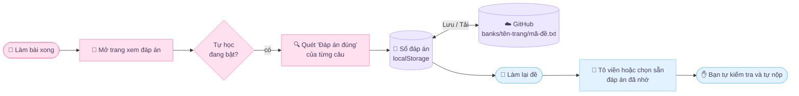

<div align="center">


🌸 ˚｡⋆ ✿ ⋆｡˚ 🌸 ˚｡⋆ ✿ ⋆｡˚ 🌸 ˚｡⋆ ✿ ⋆｡˚ 🌸


✧･ﾟ: *✧･ﾟ:*　🌸　*:･ﾟ✧*:･ﾟ✧　🌸　✧･ﾟ: *✧･ﾟ:*

</div>

<div align="center">

### 🌸 &nbsp;*Mỗi lần làm lại một đề là một lần nhớ thêm một chút* &nbsp;🌸


</div>


<div align="center">

## ✿ Mục lục ✿

[🌷 Giới thiệu](#-giới-thiệu) · [🎓 Mục đích](#-mục-đích-chỉ-để-học-tập-và-nghiên-cứu) · [🌀 Cách hoạt động](#-cách-hoạt-động) · [🌺 Tính năng](#-tính-năng) · [🗂️ Cấu trúc](#️-cấu-trúc-repo) · [🚀 Cài đặt](#-cài-đặt) · [🌙 Sử dụng](#-sử-dụng) · [📝 Phiên bản](#-lịch-sử-phiên-bản) · [⚖️ Lưu ý](#️-lưu-ý)

❀ ✿ ❁ ✾ ❀ ✿ ❁ ✾ ❀ ✿ ❁ ✾ ❀ ✿ ❁ ✾ ❀

</div>


<div align="center">🌸 ˚｡⋆ ✿ ⋆｡˚ 🌸 ˚｡⋆ ✿ ⋆｡˚ 🌸 ˚｡⋆ ✿ ⋆｡˚ 🌸</div>

## 🌷 Giới thiệu

**School** là kho lưu trữ cá nhân của mình, dùng để thử nghiệm và nghiên cứu cách một trang luyện đề trực tuyến hiển thị câu hỏi, đáp án và kết quả. Thành phần chính là **Sakura Helper**: một userscript chạy trong trình duyệt, giúp mình:

- 🌸 đọc phần **"Đáp án đúng"** ở trang xem đáp án sau khi làm bài xong,
- 🌸 lưu lại thành một **sổ đáp án** cá nhân,
- 🌸 khi làm **lại cùng đề** thì tô viền hoặc chọn sẵn đáp án đã nhớ để ôn tập nhanh hơn.

Script **không tự nộp bài**. Mọi quyết định vẫn là của người làm.

<table align="center">
<tr>
<td align="center" width="33%"><h3>🔍 Tự học</h3>Quét “Đáp án đúng” ở<br>trang xem đáp án<br><br>🌸</td>
<td align="center" width="33%"><h3>🌸 Tự chọn lại</h3>Điền lại đáp án đã nhớ<br>khi làm lại đề<br><br>🌸🌸</td>
<td align="center" width="33%"><h3>📖 Sổ đáp án</h3>Tìm kiếm, xoá từng câu,<br>xuất / nhập .txt<br><br>🌸🌸🌸</td>
</tr>
</table>


<div align="center">✧･ﾟ: *✧･ﾟ:*　🌸　*:･ﾟ✧*:･ﾟ✧　🌸　✧･ﾟ: *✧･ﾟ:*</div>

## 🎓 Mục đích: chỉ để học tập và nghiên cứu

> [!IMPORTANT]
> Dự án được viết để **tìm hiểu cách hoạt động của giao diện web**, rèn kỹ năng JavaScript (DOM, polling, `localStorage`, GitHub REST API) và hỗ trợ **tự ôn luyện**.
> Không dùng dự án này để gian lận trong bài kiểm tra, thi cử hay đánh giá chính thức. Hãy tuân thủ nội quy của trường, giáo viên và điều khoản của trang web bạn sử dụng.
> Dự án **không liên kết, không được tài trợ và không được xác nhận** bởi bất kỳ nền tảng luyện đề nào. Mọi tên thương hiệu thuộc về chủ sở hữu của chúng.

Những điều mình học được khi làm dự án:

| 🌸 Chủ đề | 📚 Nội dung nghiên cứu |
|---|---|
| Phân tích DOM | Tìm thẻ câu hỏi trong một trang SPA khi cấu trúc thay đổi liên tục |
| Xử lý văn bản | Tách phương án `A. B. C. D.` kể cả khi nằm cùng một dòng, hỗ trợ tiếng Việt có dấu |
| Đáp án dạng ảnh | Dùng tên file ảnh làm định danh, dạng `⟦img:ten-file.png⟧` |
| Câu đúng/sai | Lưu từng ý `a) b) c) d)` thành một bản ghi riêng |
| Lưu trữ | `localStorage` cộng với đồng bộ file `.txt` lên GitHub qua REST API |
| Giao diện | CSS thuần: gradient động, hiệu ứng cánh hoa, công tắc, thanh tiến trình |


<div align="center">❀ ✿ ❁ ✾ ❀ ✿ ❁ ✾ ❀ ✿ ❁ ✾ ❀ ✿ ❁ ✾ ❀</div>

## 🌀 Cách hoạt động



1. 🌸 **Nhận mã đề tự động** từ đường dẫn của trang. Sang link khác thì mã cũ được bỏ, tránh lẫn đáp án giữa các đề.
2. 🌸 **Học** ở trang xem đáp án: mỗi câu có chữ "Đáp án đúng: X", script đọc nội dung phương án X và lưu cùng mã đề.
3. 🌸 **Nhớ lại** ở trang làm bài: tìm đúng câu theo nội dung, rồi chọn hoặc tô viền phương án đã lưu. Mỗi câu chỉ chọn **một lần** và không đè lên lựa chọn của bạn.
4. 🌸 **Đồng bộ** (tuỳ chọn): đẩy hoặc tải sổ đáp án theo từng đề từ GitHub của chính bạn.


<div align="center">🌸 ˚｡⋆ ✿ ⋆｡˚ 🌸 ˚｡⋆ ✿ ⋆｡˚ 🌸 ˚｡⋆ ✿ ⋆｡˚ 🌸</div>

## 🌺 Tính năng

- ✿ Nhận dạng **trắc nghiệm**, **đáp án là ảnh** và **đúng/sai**
- ❀ Sổ đáp án có **tìm kiếm**, xoá từng câu
- ❁ **Xuất / nhập `.txt`** để sao lưu hoặc chia sẻ trong nhóm học
- ✾ Chỉ dùng đáp án của **đúng đề đang mở** (khoá theo mã đề)
- ✿ Chỉnh **độ trễ** giữa các câu, nút **Tạm dừng** bất cứ lúc nào
- ❀ Chế độ **chỉ gợi ý**: tắt tự chọn thì script chỉ tô viền đáp án đã nhớ
- ❁ Bảng điều khiển kéo thả được, thu gọn được, giao diện **Sakura** có hiệu ứng cánh hoa 🌸
- ✾ Token GitHub chỉ nhập khi lưu, **dùng xong bỏ, không lưu lại**


<div align="center">✧･ﾟ: *✧･ﾟ:*　🌸　*:･ﾟ✧*:･ﾟ✧　🌸　✧･ﾟ: *✧･ﾟ:*</div>

## 🗂️ Cấu trúc repo

```text
School/
├─ README.md                  ← bạn đang đọc
└─ sakura-repo/
   ├─ sakura-helper.user.js   ← userscript chính
   ├─ sakura-loader.user.js   ← loader: tải script từ GitHub, chuyển tiếp request khi trang chặn CSP
   └─ banks/
      ├─ <tên-trang>.txt      ← sổ chung
      └─ <tên-trang>/
         └─ <mã-đề>.txt       ← sổ riêng cho từng đề
```

> Tên file có thể khác một chút so với thực tế trong repo, hãy chỉnh lại cho khớp.

### Định dạng sổ đáp án

Mỗi dòng là một cặp `câu hỏi ||| đáp án đúng`. Dòng bắt đầu bằng `#` là ghi chú.

```text
# Mỗi dòng: câu hỏi ||| đáp án đúng
Thủ đô của Việt Nam là ||| Hà Nội
[ĐS] Nước sôi ở 100°C ở áp suất khí quyển chuẩn ||| Đúng
Mạch logic thực hiện phép toán AND có kí hiệu là : ||| ⟦img:ten-file-anh.png⟧
```

- `[ĐS]` đứng đầu: ý của câu đúng/sai, đáp án là `Đúng` hoặc `Sai`.
- `⟦img:...⟧`: đáp án là ảnh, được định danh bằng tên file ảnh.


<div align="center">❀ ✿ ❁ ✾ ❀ ✿ ❁ ✾ ❀ ✿ ❁ ✾ ❀ ✿ ❁ ✾ ❀</div>

## 🚀 Cài đặt

1. 🌸 Cài tiện ích quản lý userscript: **Tampermonkey** hoặc **Violentmonkey**.
2. 🌸 Tạo script mới và dán nội dung `sakura-helper.user.js` (hoặc mở file ở dạng *Raw* để trình quản lý tự cài).
3. 🌸 *(Tuỳ chọn)* Cài thêm **Sakura Loader** nếu muốn tải và lưu sổ lên GitHub khi trang chặn kết nối ngoài.
4. 🌸 Mở trang luyện đề, bảng điều khiển 🌸 sẽ hiện ở góc phải màn hình.


<div align="center">🌸 ˚｡⋆ ✿ ⋆｡˚ 🌸 ˚｡⋆ ✿ ⋆｡˚ 🌸 ˚｡⋆ ✿ ⋆｡˚ 🌸</div>

## 🌙 Sử dụng

| Bước | Việc cần làm |
|:-:|---|
| 🌸 1 | Làm bài như bình thường, tự nộp bài |
| 🌷 2 | Mở trang **xem đáp án**, bảng 🌸 tự quét và báo `đã quét N câu` |
| 🌺 3 | Bấm **Lưu sổ lên GitHub** (nhập token một lần) nếu muốn đồng bộ |
| 🌼 4 | Khi làm lại đề, bấm **Tải đáp án từ GitHub**, script tô viền hoặc chọn sẵn đáp án đã nhớ |
| ✨ 5 | **Tự đọc lại, tự suy nghĩ, tự nộp** |

<details>
<summary><b>🔑 Về GitHub token</b></summary>

- Dùng *fine-grained token*, chỉ cấp cho đúng repo này, quyền **Contents: Read and write**.
- Script hỏi token mỗi lần lưu và **không ghi vào `localStorage`**.
- Repo công khai thì việc tải đáp án không cần token.
- Không chia sẻ token, không commit token vào repo.

</details>

<details>
<summary><b>🛠️ Xử lý sự cố thường gặp</b></summary>

| Hiện tượng | Cách xử lý |
|---|---|
| `không khớp ảnh đáp án` | Cập nhật lên **v3.0**, F5 trang, bấm *Tải đáp án từ GitHub*, rồi xem log trong Console |
| Đáp án lưu có dính chữ "Giải thích" | v3.0 tự làm sạch, kể cả dữ liệu cũ |
| Không kết nối được GitHub | Trang đang chặn kết nối ngoài, hãy cài Sakura Loader |
| GitHub báo 403 khi tải | Đang bị giới hạn lượt gọi, chờ một lúc rồi thử lại |
| Không thấy bảng điều khiển | Kiểm tra userscript đã bật chưa, thử F5 |

</details>


<div align="center">✧･ﾟ: *✧･ﾟ:*　🌸　*:･ﾟ✧*:･ﾟ✧　🌸　✧･ﾟ: *✧･ﾟ:*</div>

## 📝 Lịch sử phiên bản

| Phiên bản | Ghi chú |
|:-:|---|
| 🌸 **3.0** | Nhận ảnh đáp án có chiều cao 0; tự bỏ chữ nút "Giải thích / Tìm Giáo Án" dính vào đáp án |
| 🌷 2.9 | Giao diện Sakura, đồng bộ GitHub theo mã đề, đáp án dạng ảnh, câu đúng/sai |


<div align="center">❀ ✿ ❁ ✾ ❀ ✿ ❁ ✾ ❀ ✿ ❁ ✾ ❀ ✿ ❁ ✾ ❀</div>

## ⚖️ Lưu ý

- 🌸 Dự án phục vụ **học tập cá nhân và nghiên cứu kỹ thuật**. Người dùng tự chịu trách nhiệm về cách sử dụng.
- 🌸 Không dùng trong các bài kiểm tra, kỳ thi hoặc bài đánh giá khi quy định không cho phép.
- 🌸 Trang web có thể thay đổi cấu trúc bất cứ lúc nào, script có thể ngừng hoạt động mà không báo trước.
- 🌸 Nếu chủ sở hữu trang hoặc nhà trường yêu cầu, mình sẽ gỡ nội dung liên quan.

<div align="center">

🌸 ˚｡⋆ ✿ ⋆｡˚ 🌸 ˚｡⋆ ✿ ⋆｡˚ 🌸 ˚｡⋆ ✿ ⋆｡˚ 🌸

### 🌸 ganbatte ne~ · 頑張って 🌸


✧･ﾟ: *✧･ﾟ:*　🌸　*:･ﾟ✧*:･ﾟ✧　🌸　✧･ﾟ: *✧･ﾟ:*


</div>
